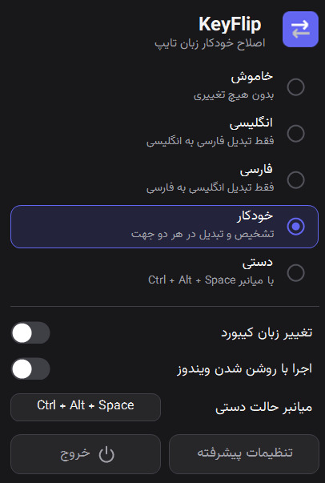
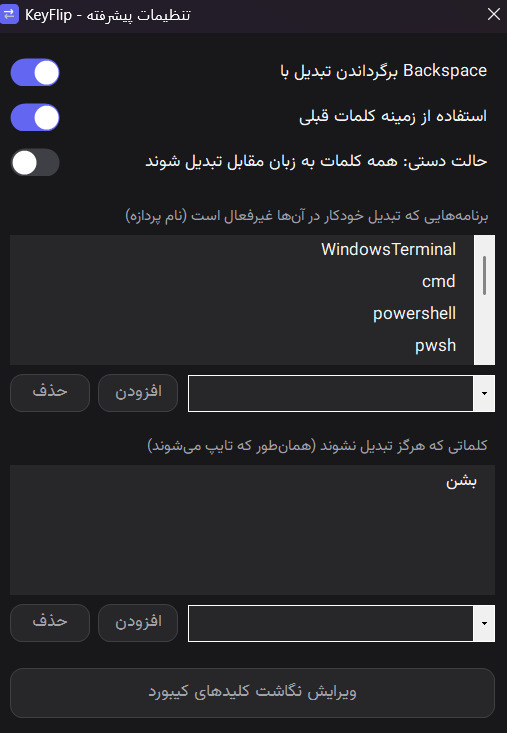
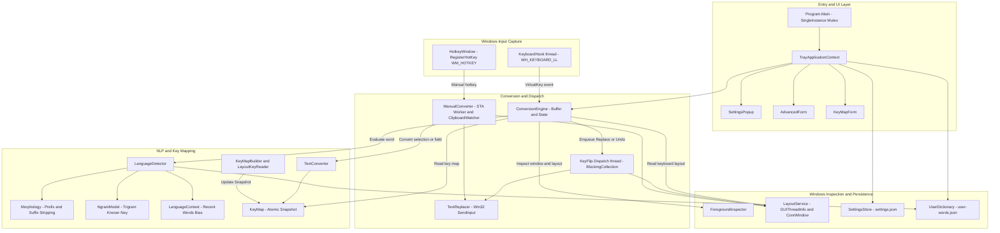
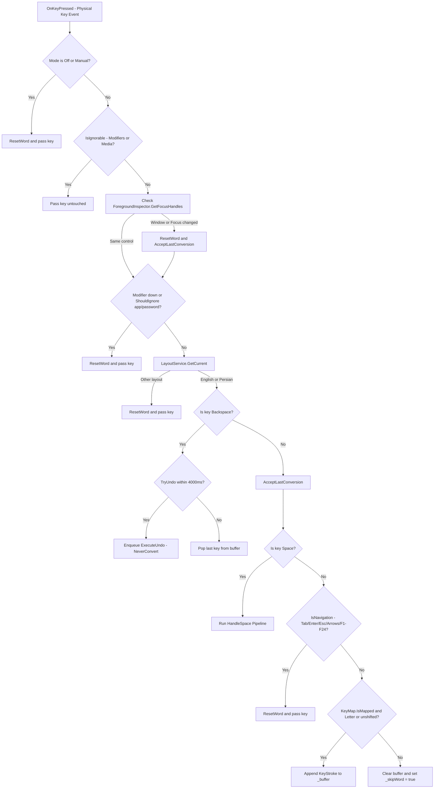
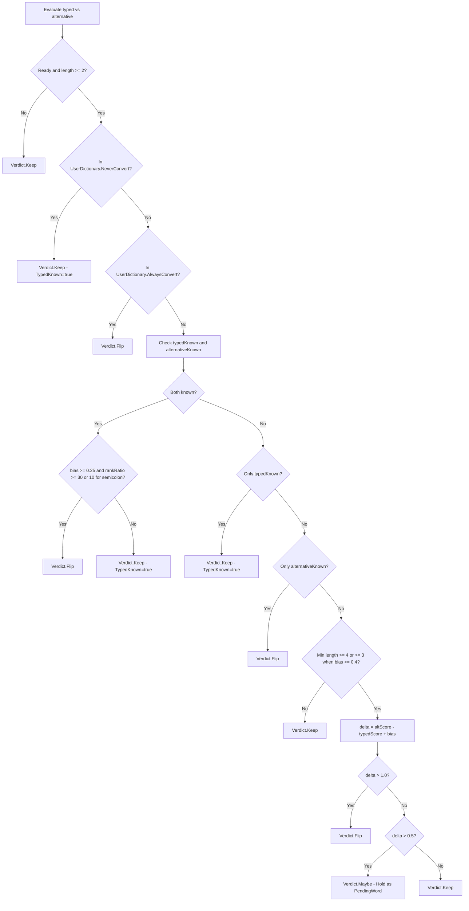
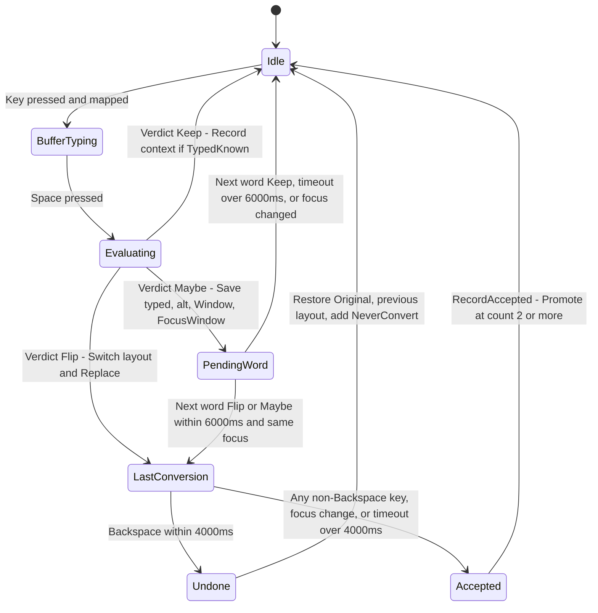
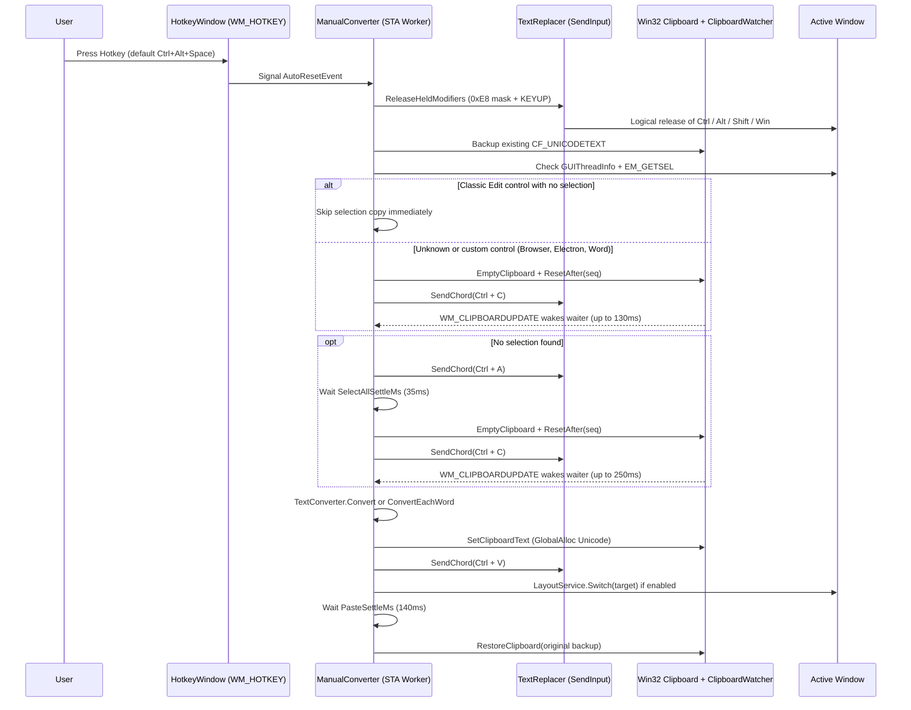

<div dir="rtl" align="right">

# KeyFlip

**ابزار هوشمند اصلاح خودکار و دستی زبان تایپ در ویندوز (انگلیسی ⇄ فارسی)**

اگر هنگام تایپ متوجه شوید چیدمان کیبورد روی زبان اشتباه بوده است (مثلاً `hdk` به‌جای «این»، `]x,vd` به‌جای «چطوری» یا «فاهس» به‌جای `this`)، نرم‌افزار **KeyFlip** کلمه یا متن را تشخیص می‌دهد، معادل صحیح آن را جایگزین می‌کند و در صورت نیاز زبان کیبورد ویندوز را نیز به‌طور خودکار تغییر می‌دهد — آن هم درون یک فایل اجرایی مستقل (`KeyFlip.exe` با حجم حدود `24.3 MiB`) بدون نیاز به نصب `.NET`.

</div>

<div align="center">


[](https://gitdiagram.com/mhkarami97/keyflip?utm_source=readme&utm_medium=badge)

<br>


<br>


</div>

<div dir="rtl" align="right">

---

## فهرست مطالب

- [امکانات کلیدی](#امکانات-کلیدی)
- [نصب و نحوه استفاده](#نصب-و-نحوه-استفاده)
- [معماری کلی برنامه](#معماری-کلی-برنامه)
- [روش کارکرد حالت خودکار](#روش-کارکرد-حالت-خودکار)
  - [چرخه پردازش هر کلید](#چرخه-پردازش-هر-کلید)
  - [منطق تشخیص زبان و امتیازدهی](#منطق-تشخیص-زبان-و-امتیازدهی)
  - [ماشین حالت کلمه معلق و بازگشت](#ماشین-حالت-کلمه-معلق-و-بازگشت)
- [روش کارکرد حالت دستی](#روش-کارکرد-حالت-دستی)
- [معرفی اجزا و ساختار کد](#معرفی-اجزا-و-ساختار-کد)
- [ترفندهای فنی و مهندسی](#ترفندهای-فنی-و-مهندسی)
- [محدودیت و نکات مهم](#محدودیت-و-نکات-مهم)
- [پیکربندی و مسیر ذخیره داده](#پیکربندی-و-مسیر-ذخیره-داده)
- [ساخت از روی سورس و کاهش حجم](#ساخت-از-روی-سورس-و-کاهش-حجم)
- [مشارکت و مجوزها](#مشارکت-و-مجوزها)

---

## امکانات کلیدی

- **پنج حالت عملکرد**: **خاموش (`Off`)**، **فقط به انگلیسی (`ToEnglish`)**، **فقط به فارسی (`ToPersian`)**، **خودکار دوطرفه (`Auto`)** و **دستی (`Manual`)**.
- **تبدیل هوشمند در پایان کلمه**: در حالت‌های خودکار، پس از زدن `Space` ساختار کلمه، واژه‌نامه بسامدی، ریشه‌یابی سبک، مدل آماری سه‌حرفی و بافت کلمات اخیر بررسی می‌شوند.
- **پشتیبانی کامل از «چ» و کلیدهای علائم فارسی**: حروف فارسیِ قرارگرفته روی کلیدهای علائم کیبورد انگلیسی (`]` ← `چ`، `[` ← `ج`، `;` ← `ک`، `'` ← `گ`، `,` ← `و`، `\` ← `پ`) هم در حالت دستی و هم در حالت خودکار (مانند `]x,vd` ← `چطوری`) پشتیبانی می‌شوند و در عین حال علامت‌گذاری واقعی انگلیسی (مانند `don't`، `it's`، `hello,`، `[hello]` و جداکننده هزارگان `1,000`) خراب نمی‌شود.
- **تبدیل دستی سریع و سازگار با ویندوز ۱۰ و ۱۱**: با زدن کلید میانبر (پیش‌فرض `Ctrl + Alt + Space`) متن انتخاب‌شده یا در صورت نبود انتخاب، کل متن فیلد تبدیل می‌شود و بدون تداخل با `Clipboard History` ویندوز ۱۰، متن قبلی کلیپ‌بورد بازگردانده می‌شود.
- **بازگشت فوری (`Undo`) و یادگیری تطبیقی**: با زدن `Backspace` تا `4` ثانیه پس از تبدیل خودکار، متن و زبان کیبورد به حالت قبل برمی‌گردند و کلمه در لیست «هرگز تبدیل نشود» ثبت می‌شود؛ در مقابل، تبدیل‌هایی که `Undo` نشوند پس از `2` بار پذیرش به لیست «همیشه تبدیل شود» ارتقا می‌یابند.
- **ایمنی در ترمینال‌ها، مدیرهای رمز و فیلدهای رمز**: تبدیل خودکار در برنامه‌های مستثنا (پیش‌فرض: `WindowsTerminal`، `cmd`، `powershell`، `pwsh`، `conhost`، `KeePass`، `KeePassXC`، `Bitwarden`، `1Password`) و کنترل‌های کلاسیک با استایل `ES_PASSWORD` متوقف می‌شود.
- **شخصی‌سازی کامل نگاشت کیبورد**: تشخیص خودکار چیدمان فارسی نصب‌شده در ویندوز بدون تغییر وضعیت صفحه کلید و امکان ویرایش تک‌تک کلیدها.
- **رابط کاربری تیره و بومی در System Tray**: با پشتیبانی از DPI بالا، فونت توکار `Vazirmatn` و اجرای اختیاری هنگام روشن شدن ویندوز.

---

## نصب و نحوه استفاده

1. آخرین نسخه فایل مستقل `KeyFlip.exe` را از بخش [Releases](../../releases) دریافت و اجرا کنید.
2. آیکون برنامه در `System Tray` (در کنار ساعت ویندوز یا داخل فلش آیکون‌های مخفی) ظاهر می‌شود.
3. با کلیک چپ روی آیکون، پنجره تنظیمات باز می‌شود که در آن می‌توانید حالت کارکرد، تغییر خودکار زبان کیبورد، اجرا هنگام ورود به ویندوز و میانبر حالت دستی را تنظیم کنید.
4. با کلیک راست روی آیکون یا زدن دکمه «تنظیمات پیشرفته»، پنجره مدیریت برنامه‌های مستثنا، کلمات «هرگز تبدیل نشوند»، تنظیمات هوش مصنوعی/زمینه و ویرایشگر نگاشت کلیدها در دسترس است.

> برای کارکرد صحیح برنامه، هر دو چیدمان **انگلیسی** و **فارسی** باید در ویندوز نصب شده باشند.  
> هنگام اجرای اولیه در ویندوز، اگر هشدار `Unknown Publisher` نمایش داده شد روی `Run anyway` کلیک کنید.

---

## معماری کلی برنامه

نقطه ورود برنامه در [`Program.cs`](Program.cs) با یک `Mutex` سراسری به نام `KeyFlip.SingleInstance` از اجرای هم‌زمان چند نسخه جلوگیری می‌کند و پس از تنظیم `WindowsFormsSynchronizationContext`، چرخه‌ی حیات برنامه را به [`TrayApplicationContext`](UI/TrayApplicationContext.cs) می‌سپارد. هسته‌ی منطقی برنامه کاملاً از رابط کاربری جدا است تا تصمیم‌گیری‌های لحظه‌ای صفحه کلید هرگز با رندر گرافیکی مسدود نشود.

</div>

<div dir="ltr" align="center">



</div>

<div dir="rtl" align="right">

### تفکیک رشته‌های اجرایی (Threading Model)

برنامه برای پرهیز از کندی تایپ یا فریز شدن رابط کاربری از چند رشته‌ی مجزا و تخصصی استفاده می‌کند:
- **رشته اصلی `UI` (`STA`)**: مدیریت `NotifyIcon`، پنجره‌های تنظیمات، [`HotkeyWindow`](Core/HotkeyWindow.cs) و [`ClipboardWatcher`](Core/ManualConverter.cs).
- **رشته [`KeyboardHook`](Core/KeyboardHook.cs) (`KeyFlip.Hook`)**: اجرای یک حلقه‌ی پیام اختصاصی (`GetMessage`) فقط برای قلاب کیبورد؛ در حالت‌های `Off` و `Manual` متوقف می‌شود تا هیچ سرباری روی تایپ نگذارد.
- **رشته [`ConversionEngine`](Core/ConversionEngine.cs) (`KeyFlip.Dispatch`)**: با اولویت `AboveNormal` و صف `BlockingCollection<Action>` مسئول اجرای `Switch` و `SendInput` است تا کالبک قلاب کیبورد هیچ‌گاه معطل `SendInput` نشود.
- **رشته [`ManualConverter`](Core/ManualConverter.cs) (`KeyFlip.Manual`)**: یک رشته‌ی دائمی `STA` با اولویت `AboveNormal` که با `AutoResetEvent` بیدار می‌شود تا نیاز به ساخت ترد جدید روی هر شورت‌کی از بین برود.
- **بارگذاری پس‌زمینه [`LanguageDetector`](Core/LanguageDetector.cs)**: خواندن ده‌ها هزار واژه از منابع داخلی (`Data/en.txt` و `Data/fa.txt`) و آموزش مدل‌های `NgramModel` روی `Task.Run` انجام می‌شود تا اجرای برنامه در Tray آنی باشد.

---

## روش کارکرد حالت خودکار

در حالت‌های خودکار (`Auto`، `ToEnglish` و `ToPersian`)، [`ConversionEngine`](Core/ConversionEngine.cs) کلیدهای تایپ‌شده را به‌صورت کد کلید مجازی (`VirtualKey`) به همراه وضعیت بزرگی/کوچکی حروف (`KeyStroke`) در بافر `_buffer` ذخیره می‌کند. این روش این مزیت مهم را دارد که برنامه دقیقاً می‌داند کاربر روی صفحه‌کلید فیزیکی چه کلیدی زده است و می‌تواند یکجا هر دو معادل انگلیسی و فارسیِ آن توالی کلید را تولید و مقایسه کند.

### چرخه پردازش هر کلید

</div>

<div dir="ltr" align="center">



</div>

<div dir="rtl" align="right">

هنگام زدن `Space` در متد [`HandleSpace`](Core/ConversionEngine.cs)، پیش از آنکه کلمه اصلاً به تشخیص‌گر زبان فرستاده شود، چهار فیلتر سریع اعمال می‌شود:
1. اگر وسط کلمه عدد یا علامت دارای `Shift` زده شده باشد (`_skipWord == true`)، کل توکن نادیده گرفته می‌شود تا عباراتی مثل `v2.0` یا `test@mail` دست نخورند.
2. طول کلمه باید حداقل `2` کلید باشد (`strokes.Length < 2` رد می‌شود).
3. تابع [`LooksStructural`](Core/ConversionEngine.cs) کلماتی با ساختار برنامه‌نویسی یا حروف بزرگ را رد می‌کند: در چیدمان فارسی هر کلیدی که همراه `Shift` باشد (اعراب، نمادها و حروف دوم کلیدها) و در چیدمان انگلیسی کلمات تماماً حروف بزرگ (مانند `API` یا `README`) یا دارای حرف بزرگ در میانه کلمه (`camelCase` و `PascalCase`) به‌عنوان متن غیرعادی شناخته و مستثنا می‌شوند.
4. جهت مجاز تبدیل با توجه به حالت انتخابی کاربر (`Auto`، `ToPersian`، `ToEnglish`) چک می‌شود (`IsDirectionAllowed`).

### منطق تشخیص زبان و امتیازدهی

وقتی دو رشته‌ی `typed` (آنچه تایپ شده) و `alternative` (معادل روی چیدمان مقابل) ساخته شدند، [`LanguageDetector.Evaluate`](Core/LanguageDetector.cs) از یک قیف تصمیم‌گیری چندلایه عبور می‌کند:

</div>

<div dir="ltr" align="center">



</div>

<div dir="rtl" align="right">

#### جزئیات دقیق لایه‌های تشخیص در `LanguageDetector`:
- **واژه‌نامه رتبه‌بندی‌شده (`en.txt` و `fa.txt`)**: تا `120,000` واژه انگلیسی و `150,000` واژه فارسی بر اساس بسامد بارگذاری و از `1` رتبه‌بندی می‌شوند. برای جلوگیری از پذیرش نویزهای کوتاه در پیکره‌ها، کلمات با طول `<= 3` فقط اگر رتبه‌ی آن‌ها زیر `20,000` (`ShortWordRankLimit`) باشد پذیرفته می‌شوند.
- **تحلیل هوشمندانه‌ی توکن‌های انگلیسی ([`IsKnownEnglishToken`](Core/LanguageDetector.cs))**:
  - اشکال کوتاه‌شده (`Contractions`) با پسوندهای `"s"`, `"t"`, `"re"`, `"ve"`, `"ll"`, `"d"`, `"m"` (مانند `it's`، `don't`، `i'm`، `we've`) ریشه‌یابی و انگلیسی شناخته می‌شوند.
  - علائم پیرامونی مانند `,` و `;` در انتها یا `[...]` و `'...'` در اطراف یک کلمه معتبر انگلیسی (مانند `hello,` یا `[hello]`) باعث می‌شوند ریشه‌ی داخلی بررسی شود تا اشتباهاً `hello,` به فارسی تبدیل نشود.
  - برای کلمات تک‌حرفی همراه با `,` یا `;` (مثل `a,` در مقابل «او» یا `j,` در مقابل «تو»)، فقط زمانی انگلیسی محسوب می‌شود که بافت اخیر هم به نفع انگلیسی باشد (`bias < 0`).
- **مقایسه دو زبان شناخته‌شده (`PrefersAlternative`)**: بعضی رشته‌ها در هر دو زبان معنی دارند (مثلاً `as` انگلیسی در برابر «شس» یا یک کلمه کوتاه در برابر واژه فارسی). تبدیل فقط وقتی رخ می‌دهد که بافت اخیر به سمت زبان مقصد متمایل باشد (`BothKnownMinBias = 0.25`) و معادل مقابل حداقل `30` برابر (`BothKnownRankRatio`) یا برای توکن‌های ختم‌شونده به `;` حداقل `10` برابر (`SemicolonRankRatio`) در رتبه‌ی بسامد پرتکرارتر باشد.
- **مدل سه‌حرفی Kneser-Ney ([`NgramModel`](Core/NgramModel.cs))**: برای کلمات خارج از واژه‌نامه (مثل اسامی جدید یا ترکیب‌های محاوره‌ای)، هر کلمه با علائم آغاز و پایان (`^^word$`) بسته‌بندی شده و میانگین لگاریتم احتمال هر کاراکتر با هموارسازی Interpolated Kneser-Ney (ضریب تخفیف `Discount = 0.75` و کف تک‌حرفی `UnigramFloor = 0.01`) محاسبه می‌شود تا مشخص شود توالی حروف چقدر شبیه زبان فارسی یا انگلیسی است.

### ماشین حالت کلمه معلق و بازگشت

برای کلماتی که نتیجه آن‌ها `Verdict.Maybe` است (شواهد آماری به سمت تبدیل هست ولی به آستانه قطعی `1.0` نرسیده)، سیستم کاربر را با تبدیل اشتباه غافلگیر نمی‌کند؛ بلکه کلمه را به‌صورت موقت در `_pending` نگه می‌دارد تا کلمه‌ی بعدی تکلیف آن را روشن کند.

</div>

<div dir="ltr" align="center">



</div>

<div dir="rtl" align="right">

---

## روش کارکرد حالت دستی

در حالت **دستی (`Manual`)**، قلاب کیبورد سراسری به‌طور کامل غیرفعال می‌شود و برنامه فقط منتظر رویداد `WM_HOTKEY` از [`HotkeyWindow`](Core/HotkeyWindow.cs) می‌ماند. تمام منطق تبدیل در [`ManualConverter`](Core/ManualConverter.cs) به گونه‌ای طراحی شده که با کمترین تأخیر ممکن روی ویندوز ۱۰ و ۱۱ اجرا شود.

</div>

<div dir="ltr" align="center">



</div>

<div dir="rtl" align="right">

#### تشخیص جهت متن در حالت دستی ([`TextConverter`](Core/TextConverter.cs)):
- اگر گزینه **تبدیل همه‌کلمه‌ای** (`ManualConvertAllWords`) خاموش باشد، کل متن به‌صورت یکجا تحلیل می‌شود: تعداد حروف لاتین و علائم نگاشت‌شده (زمانی که حداقل یک حرف لاتین وجود داشته باشد) با تعداد حروف فارسی (شامل `آ` و `ژ` و حروف نرمال‌شده `ي`←`ی` و `ك`←`ک`) مقایسه شده و جهت غالب انتخاب می‌شود.
- اگر `ManualConvertAllWords` روشن باشد، متن با الگوی `[GeneratedRegex(@"(\s+)")]` روی فاصله‌ها تقسیم شده و هر کلمه مستقل به زبان مقابل تبدیل می‌شود (ایده‌آل برای جمله‌های ترکیبی که کل متن به اشتباه آمیخته تایپ شده‌اند).

---

## معرفی اجزا و ساختار کد

پروژه از دو لایه‌ی اصلی `Core` (منطق مستقل از فرم‌ها) و `UI` (رابط کاربری و مدیریت پنجره Tray) تشکیل شده است:

### ۱. لایه هسته (`Core/`)

| فایل | کلاس / ساختار | نقش و مسئولیت |
| :--- | :--- | :--- |
| [`Core/ConversionEngine.cs`](Core/ConversionEngine.cs) | `ConversionEngine` | مغز مرکزی حالت‌های خودکار؛ مدیریت بافر کلیدها، حالت معلق (`PendingWord`)، بازگشت (`TryUndo`)، تغییر حالت (`ApplyMode`) و صف اجرا (`BlockingCollection`) |
| [`Core/KeyboardHook.cs`](Core/KeyboardHook.cs) | `KeyboardHook` | نصب و مدیریت قلاب سطح‌پایین `WH_KEYBOARD_LL` روی ترد پیام اختصاصی و عبور سریع کلیدهای تزریقی (`LLKHF_INJECTED`) |
| [`Core/ManualConverter.cs`](Core/ManualConverter.cs) | `ManualConverter` و `ClipboardWatcher` | اجرای سریع میانبر دستی روی ترد `STA`، ارتباط مستقیم Win32 با کلیپ‌بورد، تشخیص سریع `EM_GETSEL` و انتظار رویدادمحور روی `WM_CLIPBOARDUPDATE` |
| [`Core/HotkeyWindow.cs`](Core/HotkeyWindow.cs) | `HotkeyWindow` | پنجره مخفی `message-only` برای ثبت و دریافت پیام `WM_HOTKEY` در حالت دستی |
| [`Core/HotkeyFormatter.cs`](Core/HotkeyFormatter.cs) | `HotkeyFormatter` | قالب‌بندی خوانای ترکیب کلید میانبر برای نمایش در رابط کاربری (مثلاً `Ctrl + Alt + Space`) |
| [`Core/LanguageDetector.cs`](Core/LanguageDetector.cs) | `LanguageDetector` | بارگذاری و رتبه‌بندی واژگان `en.txt` و `fa.txt`، تشخیص کلمات، علامت‌گذاری‌های انگلیسی، کوتاه‌شده‌ها و ترکیب بایاس با مدل آماری |
| [`Core/Morphology.cs`](Core/Morphology.cs) | `Morphology` | حذف سبک پیشوندهای فارسی (`می`، `نمی`) و پسوندهای فارسی/انگلیسی (تا عمق `2` در فارسی) جهت تشخیص واژگان صرف‌شده |
| [`Core/NgramModel.cs`](Core/NgramModel.cs) | `NgramModel` | مدل آماری تری‌گرام کاراکتری با هموارسازی Interpolated Kneser-Ney و کدگذاری `64`-بیتی بدون ساخت رشته اضافه |
| [`Core/LanguageContext.cs`](Core/LanguageContext.cs) | `LanguageContext` | پنجره‌ی متحرک `3` کلمه‌ی اخیر (با عمر `20` ثانیه) برای تولید بایاس عددی (`±0.8`) به نفع زبان غالب متن |
| [`Core/TextConverter.cs`](Core/TextConverter.cs) | `TextConverter` | تبدیل یکجای متن یا تبدیل کلمه‌به‌کلمه، نرمال‌سازی حروف عربی (`ي`/`ك`) و حفظ ویرگول میان اعداد (`1,000`) |
| [`Core/KeyMap.cs`](Core/KeyMap.cs) | `KeyMap` | جدول نگاشت thread-safe با الگوی `Snapshot` تغییرناپذیر و جست‌وجوی اتمی کلید به انگلیسی/فارسی و برعکس |
| [`Core/KeyMapBuilder.cs`](Core/KeyMapBuilder.cs) | `KeyMapBuilder` | ساخت نگاشت پایه (از چیدمان ویندوز یا جدول استاندارد فارسی) و اعمال استثناهای دستی کاربر |
| [`Core/LayoutKeyReader.cs`](Core/LayoutKeyReader.cs) | `LayoutKeyReader` | استخراج کاراکتر واقعی هر کلید از چیدمان نصب‌شده در ویندوز با `ToUnicodeEx` و پرچم عدم تغییر وضعیت (`0x4`) |
| [`Core/LayoutService.cs`](Core/LayoutService.cs) | `LayoutService` | تشخیص زبان فعال و جابه‌جایی زبان با `WM_INPUTLANGCHANGEREQUEST` روی پنجره فوکوس واقعی یا `CoreWindow` در اپ‌های `UWP` |
| [`Core/ForegroundInspector.cs`](Core/ForegroundInspector.cs) | `ForegroundInspector` | تشخیص نام فایل اجرایی برنامه فعال (`QueryFullProcessImageName`)، پنجره فوکوس و تشخیص فیلدهای رمز (`ES_PASSWORD`) |
| [`Core/TextReplacer.cs`](Core/TextReplacer.cs) | `TextReplacer` | تزریق پاک‌سازی (`Backspace`) و کاراکترهای یونیکد با `SendInput`، ارسال ترکیب کلیدها با `ScanCode` و آزادسازی بدون‌منوی Modifierها |
| [`Core/InputState.cs`](Core/InputState.cs) | `InputState` | خواندن سریع وضعیت فیزیکی `Shift` (`GetAsyncKeyState`) و کلید قفل `CapsLock` (`GetKeyState`) |
| [`Core/UserDictionary.cs`](Core/UserDictionary.cs) | `UserDictionary` | مدیریت لیست‌های شخصی (`NeverConvert`، `AlwaysConvert` و `Accepted`) با ذخیره‌سازی با تاخیر (`Debounce 500ms`) و قفل نوشتن |
| [`Core/SettingsStore.cs`](Core/SettingsStore.cs) | `SettingsStore` | بارگذاری و ذخیره تنظیمات برنامه (`AppSettings`) از فایل JSON در پوشه کاربر |
| [`Core/AppJsonContext.cs`](Core/AppJsonContext.cs) | `AppJsonContext` | Source Generator برای `System.Text.Json` جهت حذف نیاز به Reflection و پشتیبانی کامل از `PublishTrimmed` |
| [`Core/Models.cs`](Core/Models.cs) | `AppSettings` و Enumها | مدل تنظیمات، حالت‌های تبدیل (`ConversionMode`) و زبان ورودی (`InputLanguage`) |
| [`Core/StartupManager.cs`](Core/StartupManager.cs) | `StartupManager` | ثبت یا حذف مسیر اجرایی برنامه در رجیستری ویندوز (`HKCU\...\Run`) برای اجرای خودکار |
| [`Core/NativeMethods.cs`](Core/NativeMethods.cs) | `NativeMethods` | تجمیع تعاریف P/Invoke و ثابت‌های Win32 API (کیبورد، کلیپ‌بورد، پنجره و حافظه سراسری) |
| [`Core/DebugLog.cs`](Core/DebugLog.cs) | `DebugLog` | ثبت رخدادهای تشخیصی در `debug.log` (فقط در بیلد `Debug` به‌کمک صفت `[Conditional("DEBUG")]`) |

### ۲. لایه رابط کاربری (`UI/`) و داده‌ها

| فایل | نقش و مسئولیت |
| :--- | :--- |
| [`UI/TrayApplicationContext.cs`](UI/TrayApplicationContext.cs) | مدیریت آیکون سینی سیستم (`NotifyIcon`)، منوی راست‌کلیک، هماهنگی پنجره‌های تنظیمات و ذخیره‌سازی کامل (`_user.Flush()`) هنگام خروج |
| [`UI/SettingsPopup.cs`](UI/SettingsPopup.cs) | پنجره‌ی شناور بدون حاشیه در کنار `Tray` با انیمیشن Fade-in، سایه‌ی پنجره (`CS_DROPSHADOW`)، مقیاس‌بندی DPI و پنهان‌شدن با `Deactivate` |
| [`UI/AdvancedForm.cs`](UI/AdvancedForm.cs) | پنجره تنظیمات پیشرفته (Undo، زمینه تایپ، تبدیل همه‌کلمه‌ای، برنامه‌های مستثنا با پیشنهاد پردازه‌های فعال، و لیست کلمات مستثنا) |
| [`UI/KeyMapForm.cs`](UI/KeyMapForm.cs) | ویرایشگر جدول نگاشت کلیدها به دو ستون انگلیسی/فارسی همراه با کلید بازنشانی و تشخیص خودکار از ویندوز |
| [`UI/EditableListPanel.cs`](UI/EditableListPanel.cs) | کامپوننت قابل استفاده مجدد برای نمایش و ویرایش لیست‌های Owner-Draw با پشتیبانی از جست‌وجو/پیشنهاد |
| [`UI/ModeList.cs`](UI/ModeList.cs) | لیست انتخاب ۵ حالت اصلی برنامه با رسم سفارشی و نشانگر رنگی |
| [`UI/HotkeyBox.cs`](UI/HotkeyBox.cs) | کادر ضبط کلید میانبر جدید با اعتبارسنجی اجباری وجود `Ctrl` یا `Alt` و مسدودسازی کلید `Win` |
| [`UI/ActionButton.cs`](UI/ActionButton.cs) و [`UI/ToggleSwitch.cs`](UI/ToggleSwitch.cs) | کنترل‌های رسم‌شونده اختصاصی (دکمه‌ی با حاشیه گرد و کلید کشویی مدرن) |
| [`UI/DarkMenuRenderer.cs`](UI/DarkMenuRenderer.cs) و [`UI/Theme.cs`](UI/Theme.cs) | رنگ‌بندی تیره، فونت توکار `Vazirmatn` از حافظه و هندسه‌ی گوشه‌های گرد |
| [`UI/Dwm.cs`](UI/Dwm.cs) | اعمال گوشه‌های گرد ویندوز ۱۱ و نوار عنوان تیره از طریق `dwmapi.dll` |
| [`tools/prepare_data.py`](tools/prepare_data.py) | اسکریپت پایتون برای دانلود، فیلتر، نرمال‌سازی و تولید فایل‌های بسامد کلمات در پوشه `Data/` |

---

## ترفندهای فنی و مهندسی

در توسعه **KeyFlip** از چند ترفند سطح‌پایین و الگوریتمی استفاده شده است تا برنامه بدون مصرف منابع بالا، در تمام نرم‌افزارهای ویندوز سریع و بی‌دردسر عمل کند:

### ۱. رهاسازی بی‌وقفه‌ی Modifierها با کلید تله (`0xE8`)
وقتی کاربر میانبر دستی (مثلاً `Ctrl + Alt + Space`) را فشار می‌دهد، معمولاً هنگام فعال شدن رویداد `WM_HOTKEY` هنوز کلیدهای `Ctrl` و `Alt` زیر انگشت کاربر پایین هستند. اگر همان لحظه برنامه بخواهد `Ctrl+C` بفرستد، ترکیب `Ctrl+Alt+C` اجرا می‌شود! از طرفی صبر کردن با حلقه `Sleep` تا کاربر انگشتش را بردارد باعث تأخیر آزاردهنده می‌شود؛ و ارسال مستقیم `KEYUP` برای `Alt` یا `Win` نیز در ویندوز باعث فعال شدن نوار منوی برنامه (Menu Bar) یا باز شدن منوی Start می‌شود!  
**راه‌حل در [`TextReplacer.ReleaseHeldModifiers`](Core/TextReplacer.cs)**: برنامه ابتدا یک کلید مجازی تخصیص‌نیافته و بی‌اثر (`VkMenuMask = 0xE8`) را به‌صورت Down/Up ارسال می‌کند تا ویندوز گمان کند کلید `Alt`/`Win` برای یک ترکیب مصرف شده و هنگام رها شدن نباید منو باز کند؛ سپس `KEYEVENTF_KEYUP` را همراه با `ScanCode` واقعی (`MapVirtualKey`) و پرچم `KEYEVENTF_EXTENDEDKEY` برای تمام کلیدهای Modifier نگه‌داشته‌شده می‌فرستد — تمام این کار در **۰ میلی‌ثانیه** انجام می‌شود.

### ۲. حذف گلوگاه کلیپ‌بورد ویندوز ۱۰ با Win32 API و `WM_CLIPBOARDUPDATE`
در نسخه‌های مبتنی بر `System.Windows.Forms.Clipboard`، عملیات کپی به‌ویژه در ویندوز ۱۰ بسیار کند بود؛ زیرا `Clipboard.SetDataObject(..., true)` از `COM/OLE` و `OleFlushClipboard` استفاده می‌کرد و سرویس `Clipboard History` ویندوز را درگیر می‌ساخت و حلقه‌های `Thread.Sleep` روی تایمر پیش‌فرض `15.6` میلی‌ثانیه‌ای ویندوز ۱۰ تا چند صد میلی‌ثانیه زمان هدر می‌دادند.  
**راه‌حل در [`ManualConverter`](Core/ManualConverter.cs)**:
- کار مستقیم با حافظه Win32 (`OpenClipboard`، `EmptyClipboard`، `GlobalAlloc(GMEM_MOVEABLE)`، `SetClipboardData(CF_UNICODETEXT)`) بدون درگیرکردن OLE.
- ایجاد یک پنجره `message-only` با `AddClipboardFormatListener` به نام `ClipboardWatcher` که بلافاصله با رسیدن پیام `WM_CLIPBOARDUPDATE` ترد کارگر را از خواب بیدار می‌کند؛ همچنین با نگهداری `GetClipboardSequenceNumber()` قبل از `Ctrl+C` (`_ignoreSeq`)، پیام `WM_CLIPBOARDUPDATE` ناشی از خودِ `EmptyClipboard()` نادیده گرفته می‌شود تا هیچ چرخش اضافه‌ای رخ ندهد.
- برای فیلدهای متنی کلاسیک (`Edit`/`RichEdit`) پیش از ارسال `Ctrl+C` تستی، پیام `EM_GETSEL` با `SendMessageTimeout` (`SMTO_ABORTIFHUNG` با مهلت `30` میلی‌ثانیه) فرستاده می‌شود و اگر شروعی برابر پایان انتخاب داشت، بلافاصله سراغ `Ctrl+A` می‌رود.

### ۳. یافتن کنترل ورودی واقعی در برنامه‌های `UWP` ویندوز ۱۰
در برخی اپلیکیشن‌های مدرن ویندوز ۱۰ (مثل برنامه‌های UWP میزبانی‌شده توسط `ApplicationFrameHost`)، پنجره رویی `GetForegroundWindow()` یک قاب پوششی از کلاس `ApplicationFrameWindow` است و ارسال `WM_INPUTLANGCHANGEREQUEST` به آن چیدمان کیبورد را تغییر نمی‌دهد. در [`LayoutService.ResolveInputWindow`](Core/LayoutService.cs) ابتدا `GetGUIThreadInfo(0, ...)` برای دریافت `hwndFocus` واقعی فراخوانی می‌شود و در صورت مواجهه با `ApplicationFrameWindow`، با `EnumChildWindows` پنجره‌ی داخلی `Windows.UI.Core.CoreWindow` پیدا شده و پیام تغییر زبان مستقیماً به همان ارسال می‌گردد.

### ۴. قلاب کیبورد بدون لگ و تفکیک از ارسال کلید
ویندوز یک محدودیت زمانی سخت‌گیرانه برای کالبک `WH_KEYBOARD_LL` دارد؛ اگر پردازش یک کلید طول بکشد یا هم‌زمان کار I/O/UI انجام شود، ویندوز قلاب را به‌صورت خاموش قطع می‌کند. در KeyFlip:
- کالبک قلاب روی ترد اختصاصی `KeyFlip.Hook` قرار دارد و حتی تبدیل/جایگزینی در لحظه‌ی `Space` روی صف ترد `KeyFlip.Dispatch` قرار می‌گیرد.
- کلیدهایی که خود برنامه با `SendInput` تولید می‌کند، دارای پرچم `LLKHF_INJECTED` هستند و در خط اول `KeyboardHook.OnKey` فیلتر می‌شوند تا هرگز حلقه‌ی بی‌نهایت رخ ندهد.
- ساختار نگاشت کلیدها در [`KeyMap`](Core/KeyMap.cs) به‌صورت یک شیء تغییرناپذیر `Snapshot` با `volatile` ذخیره می‌شود تا ترد قلاب بدون نیاز به `lock` داده‌ها را بخواند.

### ۵. خواندن نگاشت کیبورد ویندوز بدون به‌هم‌ریختگی کلیدهای ترکیبی مرده (`Dead Keys`)
در [`LayoutKeyReader`](Core/LayoutKeyReader.cs) برای استخراج چیدمان فارسی نصب‌شده از `ToUnicodeEx` با پرچم `DoNotChangeKeyState (0x4)` استفاده می‌شود؛ و اگر کلیدی باعث فعال شدن حالت `Dead Key` (`count < 0`) شود، یک `Space` مجازی داخل همان فراخوانی بدون تغییر وضعیت صفحه کلید سیستم ارسال می‌شود تا بافر حالت داخلی ویندوز برای کلیدهای بعدی پاک بماند.

### ۶. بهینه‌سازی حافظه و سرعت در مدل N-gram
- **پرهیز از تخصیص `string` در [`NgramModel`](Core/NgramModel.cs)**: به‌جای نگهداری سه‌تایی حروف به‌شکل رشته در دیکشنری، هر سه `char` داخل یک عدد `long` بیت‌بندی می‌شوند و از `CollectionsMarshal.GetValueRefOrAddDefault` برای شمارش درجا استفاده شده است.
- **پردازش خط‌های فرهنگ لغت با `ReadOnlySpan<char>`**: در [`LanguageDetector.LoadWords`](Core/LanguageDetector.cs) برای پارس کردن `283,147` خط واژه از فایل‌های منبع (`200,000` در `Data/en.txt` و `83,147` در `Data/fa.txt`)، به‌جای `string.Split()` از `span.IndexOf('\t')` و `double.TryParse` روی Span استفاده شده تا فشار روی Garbage Collector هنگام شروع به حداقل برسد.

### ۷. رابط کاربری تیره با WinForms، فونت توکار و کاهش حجم نزدیک به نصف
- فونت [`Vazirmatn-Regular.ttf`](Fonts/Vazirmatn-Regular.ttf) به‌صورت `EmbeddedResource` داخل EXE بسته‌بندی شده و با `GCHandle.Alloc` و `PrivateFontCollection.AddMemoryFont` در [`Theme`](UI/Theme.cs) مستقیماً از رم بارگذاری می‌شود.
- برای کاهش حجم خروجی مستقل ویندوز (که بدون بهینه‌سازی حدود `51 MB` بود) در [`KeyFlip.csproj`](KeyFlip.csproj) این تکنیک‌ها ترکیب شده‌اند:
  - فعال‌سازی **`PublishTrimmed=true`** (`TrimMode=partial` و `_SuppressWinFormsTrimError=true`) برای حذف کدهای بدون استفاده از کتابخانه‌های .NET و WinForms.
  - تعریف [`AppJsonContext`](Core/AppJsonContext.cs) (`JsonSerializerContext`) برای تولید کد Serialization در زمان کامپایل به‌جای Reflection.
  - حذف بسته‌های زبانی اضافه (`SatelliteResourceLanguages=en`) و غیرفعال‌سازی ماژول‌های دیباگ و تشخیصی زمان اجرا (`DebuggerSupport=false`، `EventSourceSupport=false`، `MetadataUpdaterSupport=false`، `HttpActivityPropagationSupport=false`، `DebugType=none`).
  - نتیجه: کاهش حجم نسخه خودکفای تک‌فایلی به **`25,485,594` بایت** (حدود `24.3 MiB`) بدون نیاز به نصب `.NET Desktop Runtime`.

---

## محدودیت و نکات مهم

- در حالت‌های خودکار، ارزیابی و تبدیل کلمه فقط هنگام فشردن کلید `Space` انجام می‌شود (نه `Enter` یا `Tab`).
- کاراکترهای دارای `Shift` در چیدمان فارسی و اعداد بین حروف در حالت خودکار پشتیبانی نمی‌شوند و چنین توکن‌هایی برای حفظ سلامت متن دست‌نخورده می‌مانند.
- حالت دستی هنگام جایگزینی از کلیپ‌بورد سیستم استفاده می‌کند و فقط متن ساده‌ی قبلی کلیپ‌بورد بازگردانده می‌شود (تصویر یا فایل کپی‌شده بازگردانی نمی‌شود).
- در برخی ویرایشگرهای کد (IDEها) که `Ctrl+C` بدون انتخاب متن کل خط را کپی می‌کند، حالت دستی بدون انتخاب فقط همان خط را تبدیل می‌کند.
- تشخیص خودکار فیلد رمز تنها برای کادرهای کلاسیک `Edit` ویندوز با استایل `ES_PASSWORD` کار می‌کند، نه فیلدهای رمز داخل مرورگرها یا اپ‌های وب/الکترون (برای آن برنامه‌ها می‌توانید نام پردازه را به «برنامه‌های مستثنا» اضافه کنید).
- در پنجره‌هایی که با دسترسی **Administrator** اجرا شده‌اند، به‌دلیل محدودیت امنیتی ویندوز (UIPI) برنامه فقط زمانی روی آن‌ها اثر می‌گذارد که خود KeyFlip نیز به‌صورت Administrator اجرا شود.
- دقت تشخیص خودکار برای کلمات بسیار کوتاه یا اسامی خاص ناشناس محدودیت ذاتی دارد.

---

## پیکربندی و مسیر ذخیره داده

تمامی داده‌های کاربر در مسیر `%AppData%\KeyFlip\` ذخیره می‌شوند:
- `settings.json`: تنظیمات عمومی، حالت فعال، کلید میانبر، لیست برنامه‌های مستثنا و تنظیمات نگاشت شخصی.
- `user-words.json`: واژگان آموخته‌شده شامل لیست «هرگز تبدیل نشود»، «همیشه تبدیل شود» و شمارنده پذیرش‌ها.
- `debug.log`: لاگ جزئیات تصمیم‌گیری (صرفاً در بیلد حالت `Debug` ایجاد می‌شود).

---

## ساخت از روی سورس و کاهش حجم

**پیش‌نیازها**: `.NET 10 SDK` و `Python 3`.

1. فایل فونت `Vazirmatn-Regular.ttf` را داخل پوشه `Fonts/` قرار دهید.
2. فهرست بسامدی کلمات را با اسکریپت پایتون آماده کنید (خروجی در `Data/en.txt` و `Data/fa.txt` ذخیره می‌شود):

</div>

<div dir="ltr" align="left">

```powershell
python tools/prepare_data.py
```

</div>

<div dir="rtl" align="right">

3. نسخه تک‌فایلی `Release` را بسازید:

</div>

<div dir="ltr" align="left">

```powershell
dotnet publish KeyFlip.csproj -c Release
```

</div>

<div dir="rtl" align="right">

خروجی نهایی در مسیر `bin/Release/net10.0-windows/win-x64/publish/KeyFlip.exe` (با اندازه `25,485,594` بایت / حدود `24.3 MiB`) ایجاد می‌شود.

> **نکته برای کاهش بیشتر حجم (نسخه وابسته به Runtime)**: اگر مطمئن هستید روی سیستم مقصد `.NET 10 Desktop Runtime` نصب است، می‌توانید در [`KeyFlip.csproj`](KeyFlip.csproj) مقدار `<SelfContained>` را `false` بگذارید (همراه با حذف `EnableCompressionInSingleFile` و `PublishTrimmed`) تا فایل خروجی تا حدود `5` مگابایت کوچک‌تر شود. در پیکربندی پیش‌فرض پروژه برای راحتی کاربران و اجرا بدون پیش‌نیاز، حالت `SelfContained` فعال مانده است.

انتشار خودکار در گیت‌هاب از طریق [`.github/workflows/release.yml`](.github/workflows/release.yml) با پوش کردن یک تگ با الگوی `v*` (مثلاً `v1.0.0`) انجام می‌شود.

---

## مشارکت و مجوزها

مشارکت در بهبود پروژه با کمال میل پذیرفته می‌شود؛ راهنمای کامل در [`CONTRIBUTING.md`](CONTRIBUTING.md) قرار دارد.

- **فهرست واژگان انگلیسی**: [Peter Norvig — `count_1w.txt`](https://norvig.com/ngrams/)
- **فهرست واژگان فارسی**: [behnam/persian-words-frequency](https://github.com/behnam/persian-words-frequency) (تحت مجوز `CC BY-SA 3.0`)
- **فونت رابط کاربری**: [Vazirmatn](https://github.com/rastikerdar/vazirmatn)

سورس‌کد KeyFlip تحت مجوز MIT ([`LICENSE`](LICENSE)) منتشر شده است. مجوز داده‌های بسامدی و فونت مجزا است؛ پیش از بازنشر فایل اجرایی یا فایل‌های `Data/*.txt` شرایط هر منبع (از جمله شرط «اشتراک به همان صورت» در `CC BY-SA`) را رعایت کنید.

</div>
